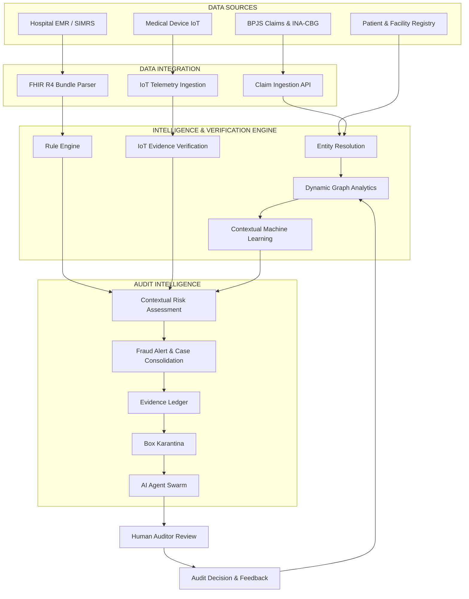

# AI Insurance Fraud Audit

Audit klaim asuransi kesehatan (JKN) dengan AI, di atas platform data BluesandAI. Isi repo ini:

| Bagian | Dokumen |
|---|---|
| App **AI JKN Audit**: cara menjalankan, port, perbedaan dari platform asal | [README-AIP-JKN.md](README-AIP-JKN.md) |
| Data BPJS **sintetis** (sequential CART synthesis) dan dasar ilmiahnya | [README-SINTETIS.md](README-SINTETIS.md), [synthetic-gen/METODOLOGI.md](synthetic-gen/METODOLOGI.md) |
| Mesin fraud realtime: aturan, model, pre-check faskes, permintaan dokumen | [docs/REALTIME_FRAUD.md](docs/REALTIME_FRAUD.md) |
| Cek klaim terhadap rekam medis SATUSEHAT (FHIR) | [docs/RME_SATUSEHAT_KONTRAK.md](docs/RME_SATUSEHAT_KONTRAK.md) |
| Bukti pemakaian alat dari IoT (sensor arus di kabel daya alat) | [docs/IOT_KONTRAK.md](docs/IOT_KONTRAK.md) |
| App faskes untuk binding IoT ke pasien (`/faskes`, untuk HP) | [docs/FASKES_APP.md](docs/FASKES_APP.md) |

**Yang tidak ada di repo ini:**
- Data BPJS asli. Semua data uji dan model di `testing/` berasal dari data sintetis.
- Kunci dan kata sandi. Salin [.env.example](.env.example) ke `.env.local` lalu isi sendiri.
- Data kerja (`data/`) dan hasil pembangkitan data sintetis (`Data Sintetis/`). Bangkitkan ulang lewat `synthetic-gen/`.

### Sistem Smart Audit Klaim BPJS Terintegrasi AIoT, Contextual Machine Learning, Graph Analytics, dan Multi-Agent AI

**AI Insurance Fraud Audit** adalah platform intelligent healthcare insurance auditing yang dikembangkan oleh **BluesandAI** untuk membantu meningkatkan akurasi, transparansi, dan efisiensi proses audit klaim Jaminan Kesehatan Nasional (JKN).

Platform ini mengintegrasikan data klaim BPJS, Electronic Medical Records (EMR), telemetry perangkat medis berbasis Internet of Things (IoT), Graph Analytics, Contextual Machine Learning, Rule Engine, dan AI Agent Swarm dalam satu ekosistem audit terpadu.

Berbeda dari sistem fraud detection konvensional yang hanya menganalisis data klaim secara terpisah, platform ini membangun contextual intelligence dengan menghubungkan berbagai sumber data dan bukti operasional. Dengan demikian, setiap indikasi anomali dapat dievaluasi berdasarkan konteks klinis, historis, relasional, dan bukti penggunaan perangkat medis.

Tujuan utamanya bukan sekadar menghasilkan fraud score, tetapi menyediakan sistem audit berbasis bukti (*evidence-based auditing*) yang membantu auditor memahami mengapa suatu klaim perlu diperiksa, bukti apa yang mendukung indikasi tersebut, serta informasi apa yang masih perlu diverifikasi.

---

## 1. Latar Belakang Permasalahan

Proses audit klaim asuransi kesehatan menghadapi tantangan yang tidak dapat diselesaikan hanya dengan pendekatan anomaly detection atau rule-based validation secara terpisah.

### 1.1 Data Silos

Informasi yang dibutuhkan untuk memverifikasi klaim tersebar di berbagai sistem:

- Data klaim BPJS dan INA-CBG.
- Electronic Medical Records (EMR) rumah sakit.
- Data diagnosis dan tindakan medis.
- Informasi penggunaan obat dan alat kesehatan.
- Data operasional perangkat medis.
- Riwayat kunjungan dan rujukan pasien.
- Riwayat klaim dan hubungan antarfasilitas kesehatan.

Ketika data tersebut tidak saling terhubung, auditor kesulitan membangun gambaran utuh mengenai suatu episode pelayanan kesehatan.

### 1.2 Limited Evidence Verification

Klaim yang diajukan belum tentu memiliki bukti operasional yang dapat diverifikasi secara independen.

Sebagai contoh, klaim penggunaan ventilator selama 96 jam perlu dibandingkan dengan catatan klinis dan bukti operasional perangkat medis, bukan hanya mengandalkan informasi durasi yang tercantum dalam klaim.

### 1.3 High False Positive Rates

Sistem deteksi yang hanya mengandalkan pola statistik atau anomali individual dapat menghasilkan banyak false positive.

Sebuah klaim mungkin tampak tidak wajar ketika dianalisis secara individual, tetapi menjadi wajar setelah mempertimbangkan:

- Kondisi klinis pasien.
- Riwayat pelayanan kesehatan.
- Rujukan antarfasilitas.
- Perpindahan rumah sakit.
- Kelas dan hak pelayanan.
- Konteks administratif dan operasional.

### 1.4 Manual Investigation

Auditor harus mengumpulkan dan mencocokkan berbagai dokumen dari banyak sumber sebelum dapat mengambil keputusan.

Proses ini membutuhkan waktu, meningkatkan beban kerja, dan membuat investigasi sulit diskalakan.

---

## 2. Solusi: Integrated Intelligent Audit Architecture

BluesandAI mengembangkan pendekatan multi-layered audit architecture yang menggabungkan verifikasi deterministik, contextual intelligence, dan AI-assisted investigation.

Sistem terdiri dari beberapa lapisan utama:

| Komponen | Fungsi |
|---|---|
| Rule Engine | Memvalidasi konsistensi administrasi dan pelayanan medis |
| EMR Integration | Mencocokkan klaim dengan rekam medis elektronik |
| AIoT Verification | Memverifikasi operasional dan durasi penggunaan perangkat medis |
| Entity Resolution | Mengidentifikasi entitas yang sama dari berbagai sumber data |
| Graph Analytics | Membangun hubungan pasien, faskes, klaim, dan jaringan rujukan |
| Contextual ML | Menghasilkan penilaian risiko berdasarkan konteks dan riwayat |
| AI Agent Swarm | Mendukung investigasi lanjutan dan penyusunan laporan audit |

Setiap komponen memiliki tanggung jawab yang berbeda tetapi saling terintegrasi melalui alur data dan mekanisme evidence correlation.

---

## 3. Arsitektur Sistem



*Diagram konseptual yang menggambarkan hubungan antarlapisan sistem.*

### Alur Kerja Sistem

1. **Data Ingestion:** Sistem menerima data klaim, kunjungan FKTP, klaim nonkapitasi, EMR, dan telemetry perangkat medis.
2. **Entity Resolution:** Mengidentifikasi identitas peserta, fasilitas kesehatan, dan relasi antardata.
3. **Rule-Based Verification:** Memeriksa konsistensi data administrasi, tindakan medis, diagnosis, dan durasi penggunaan alat.
4. **Graph Analytics:** Mengidentifikasi hubungan historis dan jaringan antarentitas.
5. **Contextual ML:** Menganalisis pola klaim dengan mempertimbangkan fitur historis dan relasional.
6. **Risk Assessment:** Menggabungkan berbagai sinyal untuk menentukan tingkat prioritas pemeriksaan.
7. **Case Consolidation:** Mengelompokkan alert berdasarkan entitas atau jaringan terkait.
8. **AI Agent Swarm:** Melakukan investigasi lanjutan terhadap kasus yang masuk ke sistem audit.
9. **Human Review:** Auditor memeriksa bukti dan menentukan tindak lanjut.

---

## 4. Core System Capabilities

### 4.1 Realtime Fraud Detection Engine

Sistem menyediakan Realtime Fraud Engine untuk mengevaluasi peristiwa klaim dan pelayanan kesehatan ketika data diterima.

Engine memproses tiga jenis peristiwa utama:

- Klaim FKRTL (Fasilitas Kesehatan Rujukan Tingkat Lanjutan).
- Kunjungan FKTP (Fasilitas Kesehatan Tingkat Pertama), termasuk rujukan.
- Klaim nonkapitasi.

Pemrosesan dilakukan melalui antrean dan worker dengan mekanisme micro-batch berdasarkan urutan kedatangan peristiwa.

Sistem menggunakan kombinasi:

- Rule-based signals.
- Deployed machine learning models.
- Entity resolution.
- Historical behavioral analysis.
- Dynamic relationship graph.
- Contextual risk scoring.
- Risk mitigation factors.

Setiap alert akan diintegrasikan ke sistem audit melalui ledger indikasi, Box Karantina, dan AI Agent Swarm.

### 4.2 Fraud Typology Detection

Dokumentasi Realtime Fraud mencakup 20 referensi modus fraud, dengan M07 dan M19 menggunakan keluarga deteksi inflated bills yang sama.

| Kode | Modus | Indikasi yang dianalisis |
|---|---|---|
| M01 | Penyalahgunaan dana kapitasi | Pola kontak dan aktivitas FKTP yang tidak wajar |
| M02 | Manipulasi klaim nonkapitasi | Tindakan berulang, tarif, dan volume abnormal |
| M03 | Rujukan tidak sesuai | Ketidaksesuaian kompetensi FKTP dan tujuan rujukan |
| M04 | Upcoding | Peningkatan tingkat keparahan dan diagnosis sekunder |
| M05 | Cloning | Klaim rawat inap identik pada beberapa peserta |
| M06 | Phantom billing | Klaim tumpang tindih dan pelayanan yang tidak konsisten |
| M07/M19 | Inflated bills | Tagihan dan top-up yang melampaui referensi |
| M08 | Pemecahan episode | Beberapa episode pelayanan pada hari yang sama |
| M09 | Unbundling | Pengajuan tindakan atau episode secara terpisah |
| M10 | Self-referral | Konsentrasi rujukan dan pola jaringan antarfaskes |
| M11 | Repeat billing | Pengajuan klaim yang berulang |
| M12 | Prolonged LOS | Lama rawat yang menyimpang dari pola historis |
| M13 | Kelas rawat | Ketidaksesuaian kelas rawat dengan hak peserta |
| M14 | Tindakan tidak dilakukan | Prosedur yang ditagihkan tanpa bukti tindakan |
| M15 | Tidak sesuai indikasi | Ketidaksesuaian diagnosis dan tindakan dengan karakteristik pasien |
| M16 | Readmisi | Rawat inap berulang dalam periode tertentu |
| M17 | Klaim fiktif obat/alkes/tindakan | Ketidaksesuaian pengadaan atau penyerahan pelayanan |
| M18 | Pengurangan obat | Jumlah obat diserahkan lebih sedikit dari yang ditagihkan |
| M20 | Manipulasi hasil pemeriksaan | Perbedaan hasil klaim dengan hasil alat atau LIS |

Tingkat cakupan deteksi dibedakan menjadi:

- **Data:** Indikasi dapat dianalisis dari data dan registri yang tersedia.
- **Proksi:** Indikasi dianalisis melalui jejak tidak langsung.
- **Kontrak:** Pemeriksaan memerlukan data tambahan yang harus dikirim oleh fasilitas kesehatan.

Dengan demikian, keberadaan aturan tidak selalu berarti seluruh bukti yang diperlukan sudah tersedia dalam dataset pengujian.

### 4.3 Graph Analytics & Entity Resolution

Sistem menggunakan pendekatan entity resolution dan dynamic graph untuk membangun hubungan antardata.

Relasi yang dianalisis meliputi:

- Peserta dengan fasilitas kesehatan.
- Fasilitas kesehatan dengan fasilitas kesehatan lainnya.
- FKTP dengan tujuan rujukan.
- Riwayat kunjungan dan klaim peserta.
- Pola keterhubungan antarpeserta dan jaringan faskes.

Entity resolution membantu mengenali entitas yang sama meskipun memiliki representasi berbeda di berbagai sumber.

Dynamic graph kemudian digunakan untuk menganalisis pola relasi yang tidak selalu terlihat melalui pemeriksaan klaim individual.

Kemampuan utamanya meliputi:

- Participant identity matching.
- Facility relationship analysis.
- Referral network analysis.
- Historical behavior correlation.
- Duplicate and overlapping claim investigation.
- Network-based anomaly detection.

Sistem juga memperhitungkan faktor mitigasi agar suatu hubungan atau anomali tidak langsung dianggap sebagai indikasi fraud.

### 4.4 Contextual Machine Learning

Contextual ML dirancang untuk meningkatkan kualitas evaluasi risiko dengan menggabungkan prediksi model dan konteks dari data historis serta relasional.

Perbedaan utamanya dengan isolated claim-level prediction adalah bahwa setiap klaim tidak hanya dinilai berdasarkan karakteristik individualnya.

Sistem dapat mempertimbangkan:

- Riwayat pelayanan peserta.
- Pola klaim fasilitas kesehatan.
- Distribusi biaya terhadap referensi historis.
- Riwayat hubungan peserta dan faskes.
- Pola rujukan dan jaringan pelayanan.
- Mitigating factors yang menjelaskan kondisi tertentu.

Komponen ML dalam Realtime Fraud mencakup:

- Deployed ML model untuk klaim FKRTL.
- Point-in-time feature evaluation.
- Historical flow features.
- TreeSHAP untuk membantu menjelaskan alert model.
- Graph-derived contextual signals.
- Rule-based risk signals.

**Contextual scoring** mengombinasikan bobot sinyal, tingkat kekuatan indikasi, dan faktor mitigasi.

Kategori keputusan operasional pada konfigurasi Realtime Fraud saat ini:

| Risk Score | Kategori | Tindak lanjut |
|---|---|---|
| < 45 | LOLOS | Tidak diprioritaskan untuk pemeriksaan |
| 45 – < 75 | PERIKSA | Membutuhkan pemeriksaan lebih lanjut |
| ≥ 75 | TAHAN | Diprioritaskan untuk investigasi |

Risk score merupakan indikator prioritas pemeriksaan, bukan keputusan hukum atau bukti definitif fraud.

Sistem juga menyediakan modul eksperimen Self-supervised Learning dan Active Learning dengan pendekatan masked autoencoder tabular (VIME). Modul ini mengeksplorasi pembelajaran representasi dan deteksi anomali dari data tanpa label, termasuk embedding dan anomaly score.

### 4.5 Rule Engine & Electronic Medical Records Integration

Salah satu fitur penting adalah integrasi Rule Engine dengan Electronic Medical Records (EMR).

Sistem dirancang untuk memverifikasi apakah tindakan medis yang ditagihkan memiliki dokumentasi pendukung di rekam medis pasien.

Contoh:

- Klaim menunjukkan tindakan kateterisasi jantung.
- EMR tidak memiliki dokumentasi tindakan yang sesuai.
- Sistem membandingkan diagnosis, tindakan, waktu pelayanan, dan hasil pemeriksaan.
- Ketidaksesuaian dapat menghasilkan indikasi untuk diperiksa auditor.

Integrasi menggunakan:

**FHIR R4 4.0.1 dan profil ID Core SATUSEHAT.**

Resource yang diproses antara lain:

| Resource | Data yang digunakan |
|---|---|
| Patient | Gender dan tanggal lahir untuk pemeriksaan identitas |
| Encounter | Episode, kelas, status, dan periode pelayanan |
| Condition | Diagnosis menggunakan ICD-10 |
| Procedure | Tindakan medis menggunakan ICD-9-CM |
| Observation | Tanda vital, laboratorium, dan pemeriksaan menggunakan LOINC |
| Medication | Informasi obat dengan referensi KFA dan sistem kode yang didukung |

Sistem menerima FHIR Bundle untuk satu episode klaim melalui kontrak integrasi yang telah didokumentasikan.

Fitur ini dirancang agar rumah sakit atau vendor SIMRS dapat mengirim data rekam medis secara terstruktur.

Rekam medis bersifat opsional bagi fasilitas yang belum terhubung. Ketidaktersediaan data EMR tidak otomatis menghasilkan indikasi pelanggaran.

### 4.6 AIoT Medical Device Verification

Platform mengintegrasikan Internet of Things untuk menyediakan bukti operasional dari perangkat medis.

Sensor menggunakan **current clamp** yang dipasang pada kabel daya perangkat tanpa harus membuka perangkat medis.

Informasi yang direkam mencakup:

- Waktu perangkat mulai beroperasi.
- Waktu perangkat berhenti.
- Durasi operasional.
- Status operasional berdasarkan karakteristik arus listrik.
- Identitas perangkat dan hubungan dengan sesi penggunaan.

Jenis perangkat yang tercakup dalam kontrak integrasi:

| Perangkat | Status yang dikenali |
|---|---|
| Ventilator | Jalan, siaga, mati |
| Hemodialisis | Jalan, idle, mati |
| ICU Bed/Monitor | Nyala, mati |
| Infusion Pump | Jalan, idle, mati |

Data IoT dibandingkan dengan informasi durasi yang diajukan pada klaim, seperti:

- `lama_icu_hari`
- `jam_ventilator`
- `sesi_hemodialisis`

Contoh skenario:

Klaim mencatat penggunaan ventilator selama 96 jam, sedangkan telemetry menunjukkan durasi operasional yang berbeda. Sistem dapat menghasilkan indikasi untuk memeriksa ketidaksesuaian tersebut.

**Batasan teknis:** Current clamp hanya mendeteksi karakteristik operasional listrik perangkat. Sensor ini tidak mengukur tanda vital pasien dan tidak dapat memastikan efektivitas tindakan medis. Status ventilator dari current clamp juga tidak digunakan untuk menyimpulkan apakah ventilasi bersifat invasif atau non-invasif.

### 4.7 Aplikasi Fasilitas Kesehatan: IoT Patient Binding

Sistem menyediakan aplikasi `/faskes` yang dirancang untuk digunakan perawat melalui smartphone.

Aplikasi ini menghubungkan identitas pasien dengan perangkat medis yang digunakan selama episode pelayanan.

Alur kerja:

1. Perawat memindai QR Code gelang pasien.
2. Perawat memindai QR Code perangkat IoT.
3. Sistem melakukan matching antara Patient ID dan Device ID.
4. Sistem memeriksa order dokter, lokasi bed, status perangkat, dan kemungkinan penggunaan oleh pasien lain.
5. Binding dengan tingkat keyakinan minimal 80% dapat dilakukan otomatis.
6. Matching 50–79% dan proses perpindahan perangkat memerlukan konfirmasi perawat.
7. Sesi penggunaan perangkat dicatat dan dikaitkan dengan kunjungan pasien.
8. Ketika pasien pulang, sesi penggunaan perangkat ditutup dan ringkasan durasi dapat digunakan untuk mendukung pengisian E-Klaim.

Aturan validasi binding mencakup:

- Pasien harus memiliki order dokter untuk jenis perangkat terkait.
- Satu pasien hanya dapat menggunakan satu perangkat untuk jenis yang sama pada satu waktu.
- Satu perangkat tidak boleh terikat pada dua pasien secara bersamaan.
- Perpindahan perangkat harus melalui konfirmasi perawat.

Dengan pendekatan ini, penggunaan perangkat medis mempunyai hubungan yang lebih jelas dengan identitas pasien dan episode pelayanan.

### 4.8 AI Agent Swarm

AI Agent Swarm berfungsi sebagai lapisan investigasi lanjutan dalam ekosistem audit.

Alert yang dihasilkan oleh Realtime Fraud diteruskan melalui mekanisme integrasi sistem audit:

```text
Realtime Fraud Alert
        |
        v
Indication Ledger
        |
        v
Box Karantina
        |
        v
AI Agent Swarm
        |
        v
Investigation Results
        |
        v
Human Auditor Review
```

AI Agent Swarm mendukung proses investigasi dengan memanfaatkan konteks dan artefak kasus yang tersedia di platform.

Fungsi yang tercakup dalam platform AIP JKN meliputi:

- AI Agent Swarm.
- Agent management.
- Missions and skills.
- Audit run history.
- Investigation reports.
- Swarm evaluation.
- ML Studio dan model management.
- Box Karantina.
- Nexus Object Explorer.
- Data Lineage.
- Pipeline Builder.

Pada Realtime Fraud sendiri tersedia ringkasan investigasi berbasis template yang menyajikan temuan, modus, bukti terkuat, jaringan terkait, dokumen yang perlu diminta, dan batasan data.

Ringkasan berbasis template tersebut berbeda dari investigasi lanjutan yang dijalankan melalui AI Agent Swarm.

### 4.9 Evidence Ledger & Case Management

Sistem tidak hanya menyimpan fraud score, tetapi juga menghubungkan indikasi dengan sumber bukti dan histori investigasi.

Informasi yang dapat ditelusuri mencakup:

- Indikasi dan modus yang terdeteksi.
- Sumber sinyal.
- Bobot dan kekuatan indikasi.
- Faktor mitigasi.
- Entitas terkait.
- Histori kasus.
- Hasil investigasi.
- Keputusan auditor.

Alert dikonsolidasikan berdasarkan entitas fokus, seperti fasilitas kesehatan, peserta, atau jaringan terkait.

Keputusan manusia terhadap suatu kasus juga dapat menjadi feedback untuk kalibrasi bobot sinyal melalui mekanisme yang disediakan sistem.

---

## 5. Data Integration & API Contracts

Sistem menyediakan kontrak integrasi agar data dari aplikasi eksternal, SIMRS, dan perangkat IoT dapat diterima secara terstruktur.

### 5.1 Claim Ingestion

Endpoint utama untuk pengiriman klaim dari fasilitas kesehatan:

```http
POST /api/aip/realtime/v1/faskes/klaim
X-Ingest-Token: <TOKEN>
Content-Type: application/json
```

Payload dapat memuat:

- Informasi klaim.
- Data diagnosis.
- Data tindakan.
- Informasi tarif dan biaya.
- Rekam medis dalam format FHIR Bundle.
- Bukti penggunaan perangkat IoT.

Field `rekam_medis` dan `iot` bersifat opsional sesuai ketersediaan integrasi pada fasilitas kesehatan.

### 5.2 EMR Integration

Data EMR menggunakan FHIR Bundle dan dapat divalidasi sebelum dikirim untuk proses audit.

Endpoint validasi:

```http
POST /api/aip/realtime/v1/faskes/rme/validasi
```

Endpoint internal untuk memperoleh skema integrasi:

```http
GET /api/aip/realtime/v1/rme/skema
```

### 5.3 IoT Integration

Data sesi perangkat dikirim melalui field `iot` bersama payload klaim.

Informasi sesi mencakup:

- `sesi_id`
- `device_id`
- `jenis`
- `peserta`
- `kunjungan`
- `mulai`
- `selesai`
- `mode`
- `jam`

Kontrak IoT juga mendukung mekanisme anchoring berbasis SHA-256 dan Merkle leaf untuk membantu menjaga integritas referensi sesi penggunaan perangkat.

Detail lengkap format data tersedia pada dokumentasi kontrak integrasi.

---

## 6. Synthetic Data & Research Methodology

Privasi data kesehatan merupakan aspek utama dalam pengembangan sistem.

Repository ini tidak mendistribusikan data BPJS asli. Data pengujian dan model dalam direktori `testing/` menggunakan synthetic data.

Sistem juga menyediakan pipeline untuk membangun dataset sintetis melalui metode **Sequential CART Synthesis**.

Tujuannya adalah menyediakan data untuk:

- Pengujian sistem audit.
- Pengembangan model machine learning.
- Evaluasi fraud detection.
- Eksperimen data integration.
- Pengujian pipeline analytics.
- Demonstrasi platform tanpa mengekspos data pasien asli.

Evaluasi synthetic data mencakup:

1. **Statistical Fidelity:** Mengukur kemiripan karakteristik statistik data sintetis terhadap data referensi.
2. **Data Utility:** Mengevaluasi kegunaan data untuk analisis dan pemodelan.
3. **Privacy Evaluation:** Mengevaluasi risiko pengungkapan informasi dari data hasil sintesis.

Proses pembangkitan ulang dataset dari data referensi asli memerlukan akses yang sah ke lingkungan dan sumber data yang berwenang. Data referensi tersebut tidak disertakan dalam repository publik.

Dokumentasi metodologi dan evaluasi:

- `README-SINTETIS.md`
- `synthetic-gen/METODOLOGI.md`
- `synthetic-gen/laporan/EVALUASI.md`

---

## 7. Repository Structure

Struktur utama repository:

```text
AI-Insurance-Fraud-Audit/
│
├── api/
│   └── Backend, API, dan modul pemrosesan sistem
│
├── web/
│   └── Frontend aplikasi dan antarmuka pengguna
│
├── docs/
│   ├── REALTIME_FRAUD.md
│   ├── RME_SATUSEHAT_KONTRAK.md
│   ├── IOT_KONTRAK.md
│   ├── FASKES_APP.md
│   └── Dokumen kontrak integrasi lainnya
│
├── synthetic-gen/
│   └── Pipeline pembangkitan dan evaluasi synthetic data
│
├── synthetic-iomt/
│   └── Komponen terkait synthetic IoMT
│
├── healthkathon/
│   └── inference-api/
│
├── testing/
│   └── Pengujian dan data pengembangan sintetis
│
├── paper_reference/
│   └── Referensi penelitian
│
├── requirements/
│   └── Dependency dan environment specifications
│
├── unstructured/
│   └── Komponen terkait pemrosesan data unstructured
│
├── README.md
├── README-AIP-JKN.md
├── README-SINTETIS.md
├── requirements.txt
├── .env.example
├── start.ps1
└── start.bat
```

---

## 8. Getting Started

Repository menyertakan environment setup dan startup scripts untuk menjalankan aplikasi pada lingkungan Windows.

### Prerequisites

- Windows PowerShell.
- Python environment sesuai dependency proyek.
- Node.js environment untuk frontend.
- PostgreSQL.
- Environment variables yang dikonfigurasi secara lokal.
- Dependency yang diperlukan oleh backend dan frontend.

### Configuration

Buat konfigurasi lokal berdasarkan file contoh:

```powershell
Copy-Item .env.example .env.local
```

Lengkapi konfigurasi sesuai kebutuhan environment lokal.

Jangan memasukkan API keys, database passwords, session secrets, atau kredensial lainnya ke repository.

### Run Application

Setelah dependency, database, dan konfigurasi lokal tersedia, jalankan:

```powershell
powershell -ExecutionPolicy Bypass -File start.ps1
```

Atau jalankan:

```text
start.bat
```

Panduan detail startup, isolasi database, port layanan, serta konfigurasi instance dijelaskan lebih lanjut pada:

[README-AIP-JKN.md](README-AIP-JKN.md)

Catatan: Startup script menggunakan konfigurasi environment dan database lokal. Fresh clone tetap memerlukan provisioning dan setup dependency sesuai dokumentasi proyek.

---

## 9. Technical Documentation

Dokumentasi lebih rinci tersedia pada file berikut:

| Dokumentasi | Deskripsi |
|---|---|
| [README-AIP-JKN.md](README-AIP-JKN.md) | Panduan aplikasi AI JKN Audit dan environment |
| [README-SINTETIS.md](README-SINTETIS.md) | Aplikasi AI JKN Synthetic dan pengelolaan dataset sintetis |
| [docs/REALTIME_FRAUD.md](docs/REALTIME_FRAUD.md) | Realtime Fraud Engine, fraud typologies, scoring, dan contextual analytics |
| [docs/RME_SATUSEHAT_KONTRAK.md](docs/RME_SATUSEHAT_KONTRAK.md) | Kontrak integrasi EMR menggunakan FHIR R4 |
| [docs/IOT_KONTRAK.md](docs/IOT_KONTRAK.md) | Kontrak integrasi telemetry dan bukti penggunaan perangkat medis |
| [docs/FASKES_APP.md](docs/FASKES_APP.md) | Aplikasi fasilitas kesehatan untuk IoT Patient Binding |

---

## 10. Security, Privacy & System Limitations

Platform dirancang dengan prinsip evidence-based auditing dan pemisahan antara indikasi, hasil analisis, dan keputusan akhir.

Beberapa prinsip penting:

**Data Privacy**
- Repository publik tidak menyertakan data BPJS asli.
- Data pengujian dan model di `testing/` menggunakan data sintetis.
- Kredensial dan konfigurasi sensitif dikelola secara lokal.

**Evidence Integrity**
- Informasi klaim, EMR, dan IoT memiliki kontrak data yang dapat divalidasi.
- Data sesi IoT mendukung mekanisme anchoring dan hash verification.
- Sumber sinyal dan faktor mitigasi dapat ditelusuri.

**Human-in-the-Loop**
- Risk score merupakan indikator prioritas pemeriksaan.
- AI-generated investigation tidak menggantikan kewenangan auditor.
- Keputusan akhir tetap berada pada pihak yang berwenang.

**Technical Limitations**
- Kelengkapan audit EMR bergantung pada data yang dikirim fasilitas kesehatan.
- IoT current sensor hanya merekam karakteristik operasional listrik perangkat, bukan kondisi fisiologis pasien.
- Sebagian modus fraud membutuhkan data tambahan dari SIMRS atau sistem rumah sakit.
- Synthetic data tidak sepenuhnya merepresentasikan seluruh kompleksitas operasional dunia nyata.
- Hasil eksperimen model pada synthetic data tidak dapat langsung dianggap sebagai performa pada data BPJS operasional.
- Implementasi integrasi memerlukan validasi, pengujian interoperabilitas, dan penyesuaian terhadap kebijakan serta regulasi yang berlaku.

---

## 11. Development Philosophy

Pengembangan AI Insurance Fraud Audit didasarkan pada beberapa prinsip:

1. **Evidence over Prediction** — keputusan audit harus memiliki bukti pendukung, bukan hanya prediksi model.
2. **Context over Isolation** — setiap anomali perlu dievaluasi berdasarkan hubungan dan riwayat yang relevan.
3. **Physical-to-Digital Verification** — aktivitas perangkat medis dapat dihubungkan dengan data digital pelayanan kesehatan.
4. **Explainable Intelligence** — setiap indikasi harus memiliki alasan, sumber sinyal, dan batasan informasi yang jelas.
5. **Human-in-the-Loop** — AI membantu investigasi, sementara keputusan akhir tetap berada pada auditor yang berwenang.
6. **Interoperability by Design** — sistem dirancang dengan kontrak API dan standar pertukaran data agar dapat terhubung dengan aplikasi eksternal.

---

## 12. About BluesandAI

**BluesandAI** adalah pengembang teknologi AIoT dan intelligent systems yang berfokus pada integrasi antara physical infrastructure, data intelligence, dan agentic AI.

Dalam proyek ini, BluesandAI mengembangkan pendekatan baru untuk healthcare insurance auditing dengan menghubungkan:

- Healthcare Data Intelligence.
- Medical Device IoT.
- Graph-based Contextual Analytics.
- Machine Learning.
- Rule-Based Verification.
- Multi-Agent AI.

Visi pengembangan sistem adalah menciptakan ekosistem audit yang lebih terintegrasi, dapat ditelusuri, dan berbasis bukti aktual dari proses pelayanan kesehatan.

**Developed by BluesandAI**

*Connecting Physical Evidence, Healthcare Data, and Agentic Intelligence for Trustworthy Insurance Auditing.*
